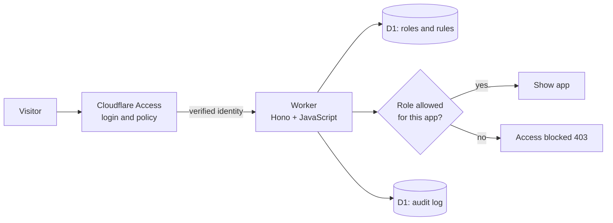

# 🎓 GateKeeper Campus

**A college portal built on Cloudflare Workers, protected by real Cloudflare Access and a Zero Trust permission layer.**

🔗 **Live deployment:** https://gatekeeper-portal.faiz414-muhammad.workers.dev

> The live site sits behind Cloudflare Access, so you will see a Cloudflare login page first. Only approved emails can sign in (one-time code sent by email).

---

## What is this project?

Traditional security trusts anyone who is "inside the network". **Zero Trust** trusts nobody by default: every request is verified, every user gets only the access their role needs, and every decision is logged.

GateKeeper Campus applies that idea to a fictional college portal with four internal apps:

| App | What it represents |
|---|---|
| 📚 **Library** | Borrowed books and catalogue (open to everyone) |
| 📝 **Exam Cell** | Timetables and results |
| 💰 **Fees** | Fee receipts and payments (sensitive) |
| 🏛️ **Admin Office** | Admissions and settings (most sensitive) |

---

## How it works (two layers)

**Layer 1: Cloudflare Access (the real gate)**
Before any request reaches the application, Cloudflare Access forces a login and checks the email against an Allow policy. Strangers never reach the code.

**Layer 2: The Worker (application-level authorization)**
After Cloudflare verifies who you are, the Worker:
1. Reads your verified identity from Cloudflare Access
2. Looks up your role in a D1 database
3. Checks whether that role may open the requested app
4. Writes the decision (allow or deny) to an audit log



---

## Roles and permissions

| Role | Library | Exam Cell | Fees | Admin Office |
|---|:---:|:---:|:---:|:---:|
| **Student** | ✅ | ❌ | ❌ | ❌ |
| **Faculty** | ✅ | ✅ | ❌ | ❌ |
| **Accounts** | ✅ | ❌ | ✅ | ❌ |
| **Admin** | ✅ | ✅ | ✅ | ✅ |

Anyone whose email has no role gets **no access** (deny by default). Only admins can read the audit log.

---

## Zero Trust principles demonstrated

| Principle | How it appears in the project |
|---|---|
| **Verify explicitly** | Cloudflare Access login plus a fresh identity check on every request |
| **Least privilege** | Each role can open only the apps it needs |
| **Deny by default** | Unknown emails and unknown apps are blocked |
| **Fail closed** | If the Access identity is missing, every route except `/health` returns 403 |
| **Assume breach / visibility** | Every allow and deny is stored with time, email, app, reason and country |
| **Short-lived sessions** | Access sessions expire and require a new email code |

---

## Tech stack

- **Cloudflare Workers** (runtime) with **Hono** (routing), written in plain JavaScript
- **Cloudflare Access** (real Zero Trust login, one-time PIN)
- **Cloudflare D1** (SQLite database for roles, app rules and the audit log)
- **Wrangler** (development and deployment)

No servers, no external services, no static assets (pages are served directly from the Worker so the Access identity reaches the code).

---

## Routes

| Route | Purpose | Who |
|---|---|---|
| `GET /health` | Heartbeat check | Always reachable |
| `GET /` | Launcher with the four apps | Signed-in users |
| `GET /app/:name` | An app page, or the "Access blocked" page | Role-dependent |
| `GET /api/me` | Your email and role | Signed-in users |
| `GET /api/apps` | Apps marked allowed or denied for your role | Signed-in users |
| `GET /admin/feed` | Live audit log page | Admin only |
| `GET /api/admin/feed` | Latest audit log rows (JSON) | Admin only |

---

## Database

Three tables, created through migrations:

- `role_map`: maps an email to a role
- `app_rules`: lists which roles may open each app
- `audit_log`: records every decision (`ts`, `email`, `app`, `decision`, `reason`, `country`)

---

## Security notes

- Identity comes only from Cloudflare Access, never from anything the client sends
- Role checks run on every request with no cached decisions
- Database access uses prepared statements, and dynamic values are escaped in HTML
- Error pages stay generic; the detailed reason is written only to the audit log
- Local testing uses a simulated identity (`access.dev`) that is not used in production

---

## Run it locally

```bash
npm install
npx wrangler d1 migrations apply gatekeeper-portal-db --local
npx wrangler dev
```

Set the simulated email in the `access.dev` block of `wrangler.jsonc` to test each role.

## Deploy

```bash
npx wrangler d1 create gatekeeper-portal-db
# put the returned database_id in wrangler.jsonc
npx wrangler d1 migrations apply gatekeeper-portal-db --remote
npx wrangler deploy
```

Then enable **Cloudflare Access** for the Worker, attach an **Allow** policy listing the permitted emails, and turn on the **One-time PIN** login method.

---

## Demo walkthrough

1. A stranger opens the link and hits the **Cloudflare login wall**
2. A **student** signs in and sees only **Library** unlocked
3. The student clicks **Fees** and gets the **Access blocked** page
4. An **admin** signs in and sees all four apps
5. The admin opens the **live audit feed** and sees the student's blocked attempt with its reason

---

## Honest scope

The login layer is the real **Cloudflare Access** product. The role-based app permissions and the audit log are my own application code built on top of it.

## Future improvements

- Temporary, admin-approved access that expires automatically (just-in-time access)
- Admin screen to manage roles from the browser
- Alerts for repeated denied attempts

---

Built by **Muhammad Faiz** as a Zero Trust portfolio project on Cloudflare.
